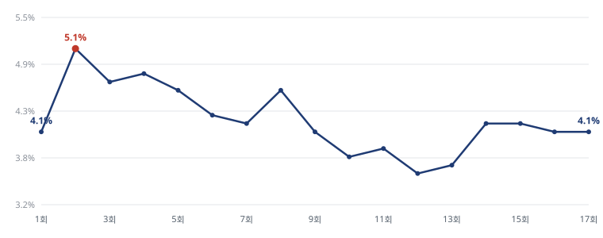
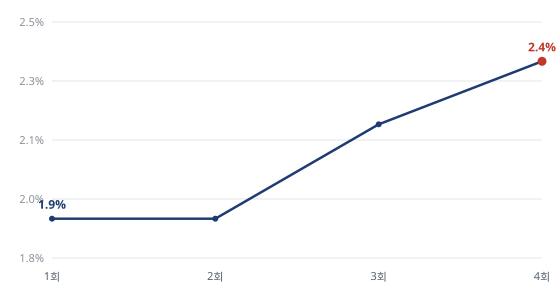

# 견본 4건 — 케이리뷰 쇼·TV채널·드라마

5번 · 2026-11-10

사장님이 주신 문장과 순서를 그대로 두고 **표와 선 그래프를 해당 부분에 넣었습니다.**
「바로보기」에는 링크를 걸었습니다. 빈칸으로 두신 곳만 채웠습니다.

```
① 쇼             전설의 사내 재방송-시청률-방송시간
② TV채널-편성표   JTBC 채널번호-편성표
③ TV채널-편성표   JTBC2 채널번호-편성표
④ 드라마          라이어 등장인물-몇부작-시청률
```

제작 순서는 지시하신 대로 **쇼 → 채널번호·편성표 → 드라마**입니다.

---
---

# 전설의 사내 재방송-시청률-방송시간

전설의 사내는 매주 수요일 방송되는 MBN 예능프로그램이다.

## (1) 전설의 사내 재방송-방송시간

전설의 사내 방송시간은 매주 수요일 밤 9시 40분이다. 11월 11일은 결방이고, 12월 1일
18회부터는 화요일 밤 9시 40분으로 옮긴다.

| | |
|---|---|
| 1회~17회 | 수요일 밤 9시 40분 |
| 11월 11일 | 결방 |
| 18회부터 | 화요일 밤 9시 40분 (12월 1일 재개) |

재방송은 MBN, GMTV, GTV, i SHOW 등에서 볼 수 있다.

OTT로는 왓챠, 웨이브, 티빙에서 스트리밍서비스 중이다.

## (2) 전설의 사내 시청률

전설의 사내는 7월 15일 1회에 4.1%로 첫 방송부터 종합편성 1위로 시작했다.

지상파까지 합쳤을 때는 시청률이 톱 10안에 들지 못했다.

최근 회차에서도 꾸준히 4%대 시청률을 유지하고 있다.



| 회차 | 방송일 | 시청률 | 회차 | 방송일 | 시청률 |
|---|---|---:|---|---|---:|
| 1회 | 7.15 | 4.1% | 10회 | 9.16 | 3.8% |
| 2회 | 7.22 | 5.1% | 11회 | 9.23 | 3.9% |
| 3회 | 7.29 | 4.7% | 12회 | 9.30 | 3.6% |
| 4회 | 8.05 | 4.8% | 13회 | 10.07 | 3.7% |
| 5회 | 8.12 | 4.6% | 14회 | 10.14 | 4.2% |
| 6회 | 8.19 | 4.3% | 15회 | 10.21 | 4.2% |
| 7회 | 8.26 | 4.2% | 16회 | 10.28 | 4.1% |
| 8회 | 9.02 | 4.6% | 17회 | 11.04 | 4.1% |
| 9회 | 9.09 | 4.1% | | | |

**[전설의 사내 시청률 바로보기](https://search.daum.net/search?w=tot&q=%EC%A0%84%EC%84%A4%EC%9D%98+%EC%82%AC%EB%82%B4+%EC%8B%9C%EC%B2%AD%EB%A5%A0)**

---
---

# JTBC 채널번호-편성표

## (1) JTBC 편성표

JTBC 편성표는 jtbc 공식홈의 편성표에서 확인할 수 있다.

**[JTBC 편성표 바로보기](https://jtbc.co.kr/schedule)**

JTBC 2, JTBC4의 편성표도 함께 확인할 수 있다.

## (2) JTBC 채널번호

### 1) IPTV-스카이라이프

JTBC 채널번호는 KT, SK브로드밴드, LG유플러스 모두 15번이다. 스카이라이프에서는 4번에서
시청할 수 있다.

| 사업자 | 채널번호 |
|---|---:|
| KT 지니 TV | 15 |
| SK브로드밴드 B tv | 15 |
| LG유플러스 | 15 |
| KT스카이라이프 | 4 |

### 2) 지역 케이블

JTBC 채널번호는 지역 케이블TV마다 달라 일일이 확인하는 게 필요하다.

| 지역 | 사업자 | 디지털 | 8VSB |
|---|---|---:|---:|
| 강남구 | 딜라이브 강남 | 15 | 15-1 |
| 강동구 | 딜라이브 강동 | 15 | 15-1 |
| 강서구 | SK브로드밴드 강서 | 4 | 20-1 |
| 관악구 | HCN | 15 | 15-1 |
| 구로구·금천구 | 딜라이브 구로금천 | 15 | 15-1 |
| 노원구 | SK브로드밴드 노원 | 4 | 20-1 |
| 노원구 | 딜라이브 노원 | 15 | 14-1 |
| 도봉구·강북구 | SK브로드밴드 도봉강북 | 4 | 20-1 |
| 동대문구 | SK브로드밴드 동대문 | 4 | 20-1 |
| 동대문구 | CMB 동대문 | 16 | 16-1 |
| 동작구 | HCN 동작 | 15 | 15-1 |
| 마포구 | 딜라이브 마포 | 15 | 15-1 |
| 서대문구 | SK브로드밴드 서대문 | 4 | 20-1 |
| 서대문구 | 딜라이브 서서울 | 15 | 15-1 |
| 서초구 | HCN 서초 | 18 | 18-1 |
| 성동구·광진구 | SK브로드밴드 광진성동 | 4 | 20-1 |
| 성동구·광진구 | 딜라이브 동서울 | 15 | 15-1 |
| 성북구 | 딜라이브 북부 | 15 | 15-1 |
| 송파구 | 딜라이브 송파 | 15 | 15-1 |
| 양천구 | LG헬로비전 양천 | 14 | 14-1 |
| 영등포구 | CMB 영등포 | 17 | 17-1 |
| 용산구 | 딜라이브 용산 | 7 | 7-1 |
| 은평구 | LG헬로비전 은평 | 14 | 14-1 |
| 종로구·중구 | SK브로드밴드 종로중구 | 4 | 20-1 |
| 중구 | 딜라이브 중앙 | 14 | 14-1 |
| 중랑구 | 딜라이브 중랑 | 14 | 14-1 |

> ※ 견본 안내 — 실제 페이지에는 인천·경기, 부산·경남, 광주·전라, 대구·경북, 대전·충청,
> 강원·제주까지 91행이 들어갑니다. 분량 때문에 서울만 실었습니다.

**[JTBC 편성표 바로보기](https://jtbc.co.kr/schedule)**

---
---

# JTBC2 채널번호-편성표

## (1) JTBC2 편성표

JTBC2 편성표는 jtbc2 공식홈의 편성표에서 확인할 수 있다.

**[JTBC2 편성표 바로보기](https://jtbc.co.kr/schedule/jtbc2)**

JTBC, JTBC4의 편성표도 함께 확인할 수 있다.

## (2) JTBC2 채널번호

### 1) IPTV-스카이라이프

JTBC2 채널번호는 KT 39번, SK브로드밴드 48번, LG유플러스 40번이다. 스카이라이프에서는
45번에서 시청할 수 있다.

| 사업자 | 채널번호 |
|---|---:|
| KT 지니 TV | 39 |
| SK브로드밴드 B tv | 48 |
| LG유플러스 | 40 |
| KT스카이라이프 | 45 |

### 2) 지역 케이블

JTBC2 채널번호는 지역 케이블TV마다 달라 일일이 확인하는 게 필요하다.

| 지역 | 사업자 | 디지털 | 8VSB |
|---|---|---:|---:|
| 강남구 | 딜라이브 강남 | 48 | 33-1 |
| 강동구 | 딜라이브 강동 | 48 | 49-1 |
| 강서구 | SK브로드밴드 강서 | 45 | 42-1 |
| 관악구 | HCN | 41 | 27-1 |

> ※ 견본 안내 — JTBC2도 서울 26행, 전국 91행이 수집돼 있습니다. 분량 때문에 4행만
> 실었습니다. JTBC4도 같습니다.

**[JTBC2 편성표 바로보기](https://jtbc.co.kr/schedule/jtbc2)**

---
---

# 라이어 등장인물-몇부작-시청률

서현진·유연석·옥자연 등이 출연하는 MBC 금·토 드라마이다. 10월 30일 첫 방송을 했다.

## (1) 라이어 등장인물

### 1) 지선-서현진

진실을 주장하는 여자, 상천해온초등학교 사서교사

차분하고 단단한 얼굴.

현수의 학교에서 준호를 만나 가까워졌지만, 그날 밤의 일을 준호와 전혀 다르게 기억한다.
주변의 시선이 자신에게 돌아서는 순간에도 자기가 겪은 것을 사실이라고 말한다.

### 2) 준호-유연석

사실을 말하는 남자, 상천대학교병원 심장외과 전문의

부드럽고 반듯한 얼굴.

아들 현수가 가장 친한 친구이자 삶의 가장 큰 기쁨이 되어 주지만, 마음속 깊은 곳에는 늘
서늘한 바람이 불었다. 현수의 학교 교사인 지선을 우연히 만난 준호는 오랜만에 호기심과
떨림을 느꼈다.

### 3) 화영-옥자연

사건을 맡은 여자, 상천경찰서 여성청소년과 형사(경위)

차분하고 서늘한 얼굴.

두 사람의 진술이 정면으로 엇갈리는 사건을 맡는다. 어느 쪽 말도 먼저 믿지 않고 남은 증거를
따라간다.

### 그 밖의 인물

| 배역 | 배우 | 소개 |
|---|---|---|
| 강지은 | 김지현 | 상천대학교병원 마취과 전문의 |
| 김형수 | 이천희 | 전업주부. 강지은의 남편 |
| 박중현 | 오동민 | 상천대학교병원 원무과 직원 |
| 민현수 | 강지용 | 상천해온초등학교 5학년. 준호의 아들 |
| 주은혜 | 정지우 | 준호와 사별한 아내 |
| 장두일 | 정승길 | 상천경찰서 여성청소년과 팀장(경감) |
| 박석구 | 임성재 | 해군 특수전전단 소령 |
| 김소연 | 유하연 | 상천해온초등학교 5학년 학생 |

## (2) 라이어 몇 부작-시청률

### 1) 라이어 몇 부작

라이어는 12부작으로 12월 5일까지 방영한다.

| 회차 | 방영일 | 회차 | 방영일 |
|---|---|---|---|
| 1회 | 10.30 (금) | 7회 | 11.20 (금) |
| 2회 | 10.31 (토) | 8회 | 11.21 (토) |
| 3회 | 11.06 (금) | 9회 | 11.27 (금) |
| 4회 | 11.07 (토) | 10회 | 11.28 (토) |
| 5회 | 11.13 (금) | 11회 | 12.04 (금) |
| 6회 | 11.14 (토) | 12회 | 12.05 (토) |

### 2) 라이어 시청률

라이어는 1회에 1.9% 시청률을 기록했다. 3회에 들어서며 라이어 시청률은 2%가 넘기
시작했다. 라이어 시청률은 3회 2.2%, 4회 2.4%였다.



| 회차 | 방영일 | 시청률 |
|---|---|---:|
| 1회 | 10월 30일 | 1.9% |
| 2회 | 10월 31일 | 1.9% |
| 3회 | 11월 6일 | 2.2% |
| 4회 | 11월 7일 | 2.4% |

**[라이어 시청률 바로보기](https://search.daum.net/search?w=tot&q=%EB%9D%BC%EC%9D%B4%EC%96%B4+%EC%8B%9C%EC%B2%AD%EB%A5%A0)**

---
---

# 사장님께

## 1. 주신 문장을 그대로 두었습니다

문장과 순서를 바꾸지 않았습니다. 표와 선 그래프만 해당 부분에 넣었고, 빈칸으로 두신 곳만
채웠습니다. 「바로보기」에는 링크를 걸었습니다.

```
JTBC 편성표 바로보기      →  jtbc.co.kr/schedule
JTBC2 편성표 바로보기     →  jtbc.co.kr/schedule/jtbc2
전설의 사내 시청률 바로보기  →  다음 검색
라이어 시청률 바로보기     →  다음 검색
```

JTBC2 편성표는 JTBC 공식홈 편성표 메뉴 안에 JTBC2 주소가 따로 있습니다. 그 주소를
걸었습니다.

## 2. 빈칸을 채운 곳

```
JTBC2 ~번            →  KT 39 · SKB 48 · LGU+ 40 · 스카이라이프 45
전설의 사내 ()시      →  밤 9시 40분
지선·화영 소개        →  준호 소개와 같은 형태로 작성
```

## 3. 고친 곳 세 군데

```
전설의 아내     →  전설의 사내      오타
되어 주시만     →  되어 주지만      오타
MBC 목·금      →  MBC 금·토       10월 30일은 금요일입니다
```

## 4. 선 그래프

시청률을 선 그래프로 넣었습니다. 0부터 그리지 않습니다. 0을 바닥으로 잡으면 4.1%와
4.8%가 거의 같은 높이로 보여서 추이가 안 보입니다. 가장 높은 회차는 붉은 점으로
표시했습니다.

빠진 회차는 0으로 채우지 않고 선을 끊습니다. 선이 바닥으로 떨어지면 시청률이 0이었다는
뜻이 되기 때문입니다.

## 5. 제작 순서와 사진

지시하신 대로 **쇼 → 채널번호·편성표 → 드라마** 순으로 만듭니다.

```
채널 페이지     해당 채널의 CI·BI + 대표 프로그램 사진
프로그램 페이지   해당 방송에 포함된 사진 (방송사 공식 페이지 게재분)
```

승인해 주시면 사진을 넣은 완성본을 한 편 올려서 다시 확인받겠습니다.
