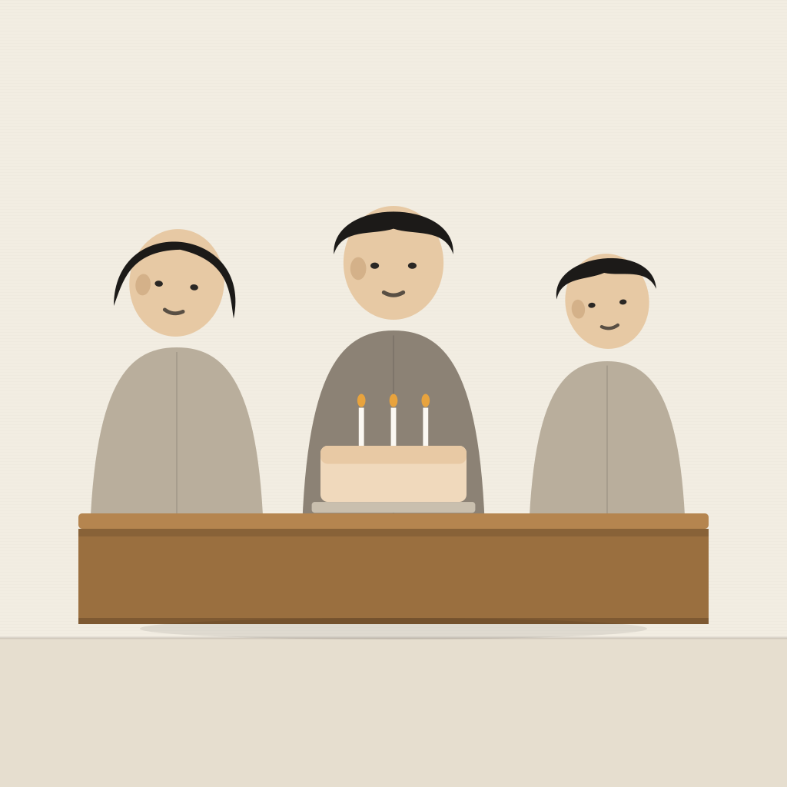
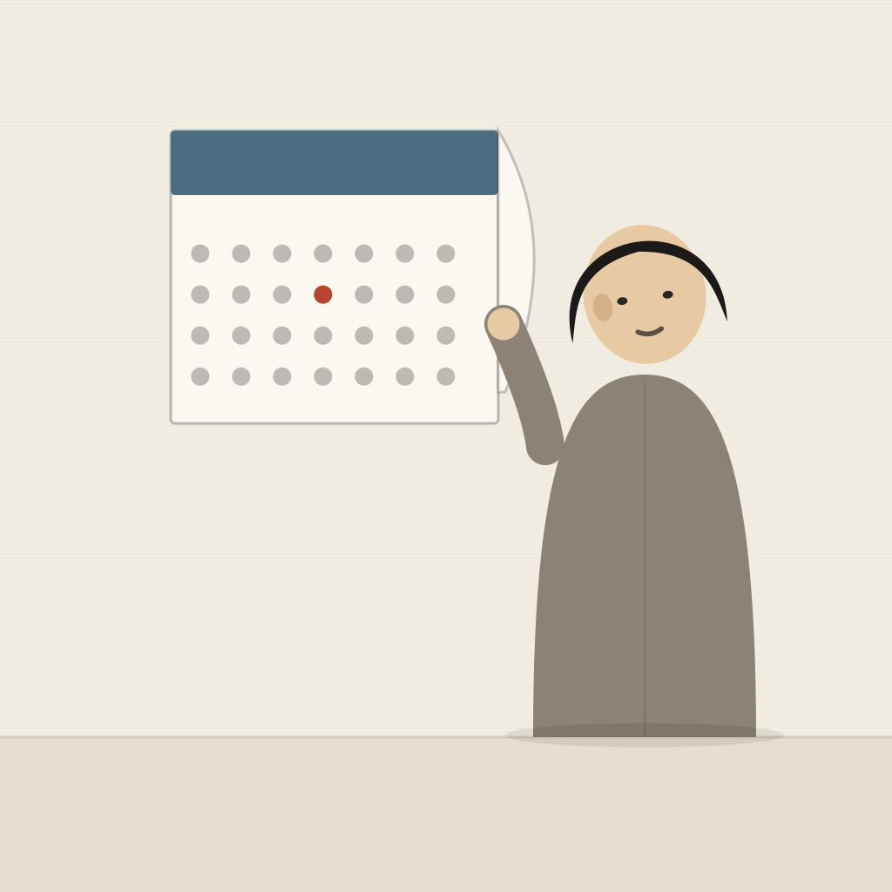

# 「철학과 미신 사이」 삽화 18장 — ⑬~㉚

2026-11-15 · 5번
한국인 등장 · 1024×1024 · 사진풍. 인쇄에 바로 쓰실 수 있도록 정사각으로 맞췄습니다.

---

## ⑬ 사주로 보는 직업, 무엇을 알려 주나

---

## ⑭ 태어난 시간 모르면 사주 못 보나

---

## ⑮ 올해 안에 만난다는 말, 사주로 알 수 있나

---

## ⑯ 오늘의 운세, 나 한 사람 보고 쓴 글이 아니다

---

## ⑰ 돼지꿈 꾸면 복권 산다는 말, 어디서 왔나

---

## ⑱ 신년운세, 1월 1일부터인가 입춘부터인가

---

## ⑲ 토정비결은 왜 태어난 시간을 묻지 않나

---

## ⑳ 「살이 끼었다」는 말, 겁먹을 일인가

---

## ㉑ 정관·식신·상관, 명칭이 열 개인 이유 (상)

---

## ㉒ 「정관이 있으면 좋다」는 말이 성립하지 않는 이유 (하)

---

## ㉓ 나이 세는 법이 세 가지인 나라, 그런데 사주는 네 번째다

---

## ㉔ 만세력, 앱마다 결과가 다른 이유

---

## ㉕ 환갑은 왜 예순한 살인가

---

## ㉖ 내 별자리는 사실 세 개다

---

## ㉗ 별자리 경계에 태어난 사람, 둘 다인가

---

## ㉘ 별자리가 13개라는 말, 사실인가

---

## ㉙ 타로는 뽑을 때마다 다른데 왜 맞는 것 같나

---

## ㉚ 사주와 심리검사, 무엇이 다른가 (마지막 회)

